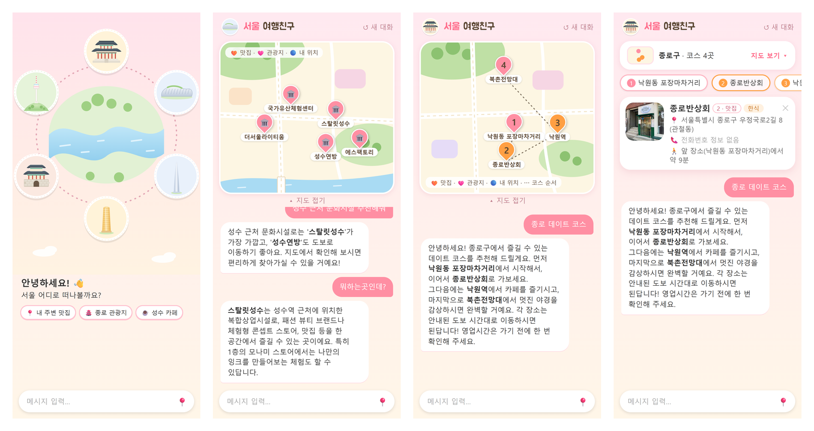
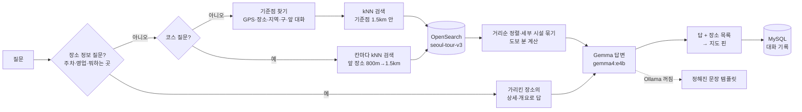
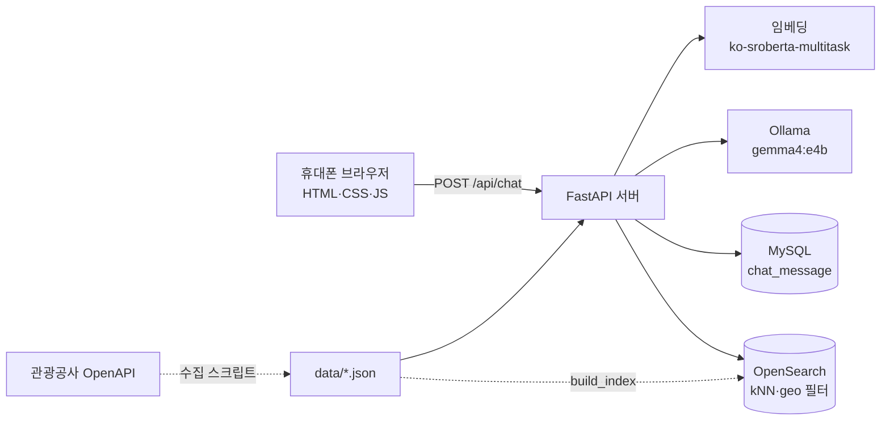

# 서울 여행 친구

서울을 여행하는 사람이 **휴대폰으로 대화하듯 물어보면** 근처 맛집·관광지·카페를 추천하고,
**귀여운 일러스트 지도에 핀으로** 보여 주는 챗봇입니다.
"거기 주차돼?", "2번은 뭐하는 곳이야?"처럼 앞 대화를 이어서 물을 수 있고,
"종로 데이트 코스"라고 하면 **걸어서 이어지는 3~4곳 코스**를 짜 줍니다.

  

> 한국관광공사 데이터에 있는 서울 장소 3,441곳 안에서만 추천합니다.
> 도보 시간은 직선거리로 계산한 **대략값**이고, 영업시간은 가기 전에 한 번 확인해 주세요.

## 주요 기능

### 1. "근처"를 알아듣는 추천
질문에서 **기준점**을 찾아 그 주변 1.5km 안에서 고르고, 물어본 주제에 맞는 곳을 먼저, 그다음 가까운 순으로 3~5곳을 보여 줍니다.

| 기준점 | 예시 |
|---|---|
| 📍 내 위치 (GPS) | 입력창의 📍 버튼, "내 주변 맛집" |
| 장소 이름 | "경복궁 근처 카페" |
| 지역·동·구 이름 | "성수 문화시설", "망원동 맛집", "강서구 공원" |
| 앞 대화의 장소 | "거기 근처 식당도 있어?" |

종류(맛집·카페·관광지·쇼핑·축제·레포츠)와 세부 주제(야경·산책·역사·전시 등)를 함께 알아듣고,
같은 장소의 세부 시설(경복궁 → 경복궁 건청궁)이 목록을 차지하지 않게 하나만 남깁니다.

### 2. 일러스트 지도와 장소 카드
- 추천 장소를 크림색 일러스트 지도 위 핀으로 표시합니다 (맛집 주황 · 관광지 분홍 · 내 위치 파랑).
- 핀이나 장소 칩을 누르면 **사진 · 분류 · 주소 · 전화 · "○○에서 약 N분"** 카드가 뜹니다.
- 지도를 접으면 요약 바와 장소 칩만 남아 대화를 넓게 볼 수 있습니다.
- 답에 나온 장소 이름은 **굵게** 보여 한눈에 찾을 수 있습니다.

### 3. 이어서 묻기 (멀티턴)
| 이렇게 물으면 | 이렇게 답합니다 |
|---|---|
| "2번 주차돼?", "마지막 곳 몇 시에 열어?" | 순서로 가리킨 장소의 상세 정보 |
| "거기 뭐하는 곳이야?", "뭐하는곳인데?" | 고른 장소(없으면 방금 본 첫 장소)를 관광공사 개요로 소개 |
| "아까 그 카페 전화번호" | 앞서 보여 준 목록에서 찾아 답함 |
| "다른 데 더 보여줘" | 같은 조건에서 이미 보여 준 곳을 빼고 다음 후보 |
| "카페는?", "그럼 산책할 곳은?" | 지역은 그대로, 종류만 바꿔서 추천 |

물어본 정보가 데이터에 없으면 지어내지 않고 "○○ 정보는 없어요"라고 말한 뒤 전화번호를 안내합니다.
대화는 MySQL에 저장되어, 새로고침해도 대화와 지도가 그대로 돌아옵니다.

### 4. 🚶 추천 코스
"코스", "동선", "일정 짜줘"라고 하거나 데이트를 말하면("데이트 추천해줘", "기념일인데 어디 가지") 코스로 답합니다.

| 테마 | 칸 순서 |
|---|---|
| 데이트 | 볼거리 → 맛집 → 카페 → 야경 |
| 쇼핑 + 맛집 | 쇼핑 → 맛집 → 카페 |
| 직접 조합 ("궁 보고 밥 먹고 카페") | 말한 순서대로 |
| 기본 ("코스 짜줘") | 관광지 → 맛집 → 관광지 → 카페 |

- 다음 칸은 앞 장소에서 **800m 안**(없으면 1.5km까지)에서 고르고, 걷는 거리 합은 3km를 넘지 않습니다.
- 지도에 **번호 핀과 갈색 점선**, 카드에 **"앞 장소(…)에서 약 N분"**이 나옵니다.
- 맞는 곳이 없는 칸은 억지로 채우지 않고 빼며, 카페가 빠지면 그 사실을 답에 밝힙니다.
- "다른 코스"라고 하면 같은 조건에서 보여 준 곳을 빼고 다시 짭니다.

## 동작 흐름

- **검색은 "후보 고르기"만:** OpenSearch는 질문과 의미가 가까운 장소 id만 돌려주고, 장소 정보·거리·도보 시간은 앱이 데이터 파일(카탈로그)에서 계산합니다.
- **반경 안에서 검색:** kNN에 거리 필터를 함께 걸어, 장소가 많은 동네에서도 가까운 곳이 빠지지 않습니다.
- **LLM이 꺼져도 동작:** Ollama에 연결되지 않으면 정해진 문장으로 답하고, 장소 목록과 지도는 그대로 나옵니다. 검색 서버가 꺼지면 오류 말풍선으로 알립니다.

## 시스템 구조

## 데이터

한국관광공사 OpenAPI(국문 관광정보 서비스)로 서울 장소를 받아 정리했습니다. 숙박은 받지 않았습니다.

| 종류 | 장소 수 |
|---|---|
| 음식점 | 1,586 |
| 관광지 | 764 |
| 문화시설 | 579 |
| 쇼핑 | 199 |
| 축제·행사 | 188 |
| 레포츠 | 125 |
| **합계** | **3,441** |

| 보강 정보 | 있는 곳 |
|---|---|
| 개요 (어떤 곳인지 소개) | 2,985곳 |
| 상세 (주차·이용 시간·쉬는 날·메뉴·요금 등) | 2,446곳 |
| 전화번호 | 586곳 |

- 쇼핑은 4,392곳 중 시장·백화점·쇼핑몰·쇼핑 거리 등 199곳만 남겼습니다(개별 브랜드 매장·약국 제외, 목록은 `data/raw/shopping_kept.tsv`).
- 이름이 같은 장소가 50m 안에 겹치면 하나만 남겼습니다.
- 임베딩 문장 = 장소 이름 · 구 · 분류 · 주소 + 개요 앞 150자.

## 사용 기술

| 구분 | 사용 |
|---|---|
| 서버 | FastAPI, Pydantic |
| 검색 | OpenSearch 3.3 (k-NN lucene HNSW, cosine, geo_distance 필터) |
| 임베딩 | sentence-transformers `jhgan/ko-sroberta-multitask` (768차원) |
| 답변 | Ollama `gemma4:e4b` (꺼지면 템플릿 답변) |
| 대화 기록 | MySQL 8.0 |
| 화면 | HTML · CSS · JavaScript (빌드 없음, SVG 일러스트 지도) |
| 테스트 | pytest, node:test, 헤드리스 Chrome(CDP) 화면 점검 |

## 준비

1. `pip install -r requirements.txt`
2. Docker로 OpenSearch와 MySQL을 띄웁니다.

       docker run -d --name seoul-opensearch -p 9200:9200 -e "discovery.type=single-node" -e "OPENSEARCH_INITIAL_ADMIN_PASSWORD=<관리자 비밀번호>" opensearchproject/opensearch:3.3.2
       docker run -d --name seoul-tour-mysql -p 3306:3306 -e MYSQL_ROOT_PASSWORD=<비밀번호> -e TZ=Asia/Seoul -v seoul-tour-mysql-data:/var/lib/mysql mysql:8.0
       docker exec -i seoul-tour-mysql mysql -uroot -p<비밀번호> < scripts/init_db.sql

   - OpenSearch 관리자 비밀번호는 8자 이상, 대문자·소문자·숫자·특수문자를 모두 넣어야 합니다.
3. Ollama를 설치하고 답변 모델을 받습니다. (임베딩 모델은 처음 실행할 때 자동으로 받습니다.)

       ollama pull gemma4:e4b

4. `.env.example`을 `.env`로 복사하고 OpenSearch·MySQL 계정을 넣습니다.
   - `TOUR_API_KEY`(관광공사 API 키)는 데이터를 새로 받을 때만 필요합니다. 저장소의 `data/`를 그대로 쓰면 비워 둬도 됩니다.
   - 인덱스 이름 `OPENSEARCH_INDEX`는 `seoul-tour-v3`로 둡니다.

## 검색 인덱스 만들기 (처음 한 번)

    python scripts/build_index.py

`data/seoul_tour.json`과 `data/seoul_tour_enriched.json`으로 3,441곳을 임베딩해 `seoul-tour-v3` 인덱스에 넣습니다.

### 데이터를 새로 받을 때

관광공사 API는 하루 호출 한도(약 1,000건)가 있어 모든 스크립트가 **이어 받기**를 지원합니다. 한도에 걸리면 다음 날 같은 명령을 다시 실행하면 됩니다.

    python scripts/fetch_list.py        # 서울 장소 목록 (관광지·문화시설·레포츠·음식점·쇼핑·축제)
    python scripts/analyze_list.py      # 분포·중복 보고 (파일은 바꾸지 않음)
    python scripts/build_merged.py      # 거르기·합치기 → data/raw/seoul_merged.json
    python scripts/fetch_overview.py    # 개요
    python scripts/enrich_detail.py     # 상세 (주차·이용 시간·메뉴 등)
    python scripts/enrich_tel.py        # 전화번호
    python scripts/apply_merged.py      # 앱 데이터 파일에 반영
    python scripts/build_index.py       # 인덱스 다시 만들기

## 실행

    python -m uvicorn app.main:create_app --factory --port 8000

- 화면: http://localhost:8000 (휴대폰 화면 기준. PC에서는 개발자 도구의 모바일 보기 추천)
- API 문서: http://localhost:8000/docs
  - `POST /api/chat` 대화 한 턴, `GET /api/history/{session_id}` 대화 기록, `GET /api/health` 상태
- 임베딩 모델을 불러오느라 시작까지 30초쯤 걸립니다.

## 테스트

    python -m pytest -m "not integration"              # 단위·API 테스트 533개 (OpenSearch·Ollama·MySQL 없이)
    python -m pytest -m integration                    # 실데이터 통합 테스트 64개 (서비스 실행 중)
    node --test tests/js/*.mjs                         # 화면 함수 테스트 65개
    node scripts/qa_mobile/run_course.mjs <폴더>       # 헤드리스 Chrome으로 휴대폰 화면 점검 (스크린샷 저장)

- 통합 테스트는 실제 인덱스로 코스 동선(연속 장소 1.5km 이하, 세부 시설 중복 없음), 멀티턴 지칭, 기준점 판정 등을 확인합니다.
- 화면 점검 스크립트(`run.mjs`, `run_b89.mjs`, `run_course.mjs`)는 iPhone 14 Pro 크기로 핀·카드·칩·대화 복원을 확인합니다. 결과표: [docs/manual-qa.md](docs/manual-qa.md)

## 문서

- 설계: [docs/superpowers/specs/2026-10-23-seoul-tour-chatbot-design.md](docs/superpowers/specs/2026-10-23-seoul-tour-chatbot-design.md)
- 데이터 확장 설계: [docs/superpowers/specs/2026-10-27-data-expansion-design.md](docs/superpowers/specs/2026-10-27-data-expansion-design.md)
- 추천 코스 설계: [docs/superpowers/specs/2026-10-28-course-design.md](docs/superpowers/specs/2026-10-28-course-design.md)
- 화면 시안: [docs/superpowers/mockups/](docs/superpowers/mockups/)

## 폴더

- `app/` 서버 — `chat.py` 대화 흐름, `center.py` 기준점, `recommend.py` 추천, `course.py` 코스, `dialog.py` 멀티턴 해석, `llm.py` 프롬프트·템플릿, `search.py` 검색
- `static/` 화면 — `js/map.js` 일러스트 지도, `js/view.js` 카드·말풍선·칩
- `scripts/` 데이터 수집·인덱스, `scripts/qa_mobile/` 화면 점검
- `data/` 장소 데이터, `data/raw/` 관광공사 원본
- `tests/` 단위·API·통합·JS 테스트
- `docs/` 설계·계획·시안·점검 기록, `docs/images/` README 화면 캡처
